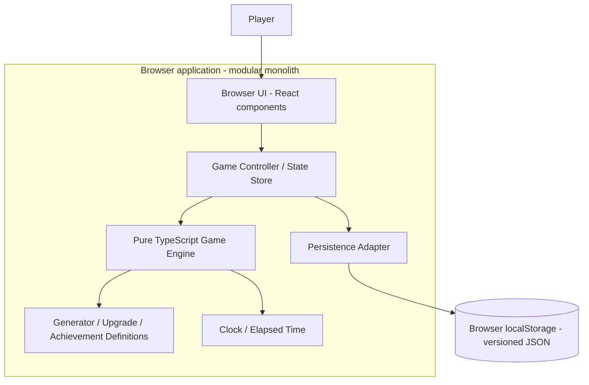

# Architecture diagram (C4-inspired component view)

**Legend:** All components execute in the user's browser. Arrows represent calls/data dependencies, not HTTP requests. `Store` coordinates actions and update ticks; `Engine` owns rules; `Save` reads/writes only localStorage. No backend or database server is needed for the MVP. Keep this diagram aligned with the actual project as implementation progresses.
